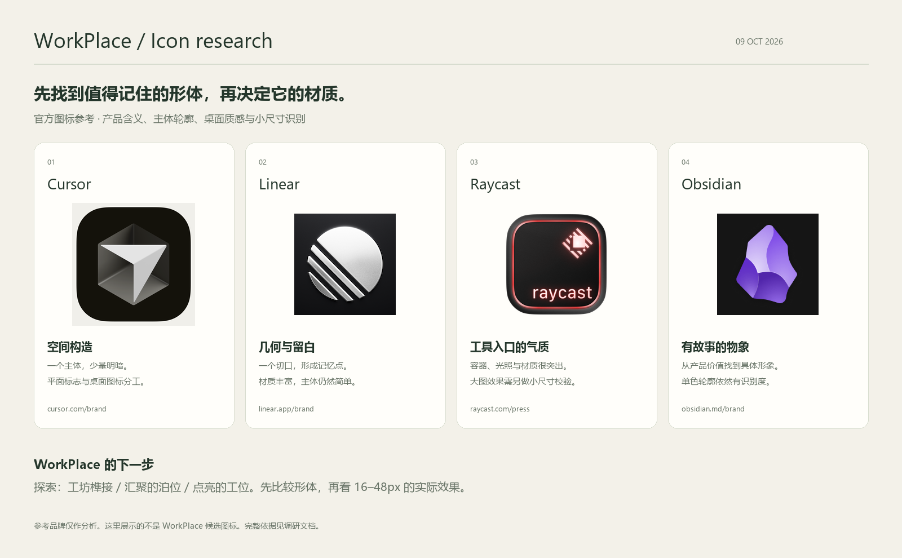

# WorkPlace 图标调研与设计任务书

调研日期：2026-10-09，Asia/Shanghai。先核对项目文档和实际图标调用，再读取官方品牌资料、原始图片与平台规范。

## 结论

优先探索 **“可组合的个人工坊”**：把不同工具接合成一件完整、稳定的创作器物。它应有独立的轮廓，能让人记住；桌面版可以呈现克制的体积与材质，托盘版保留同一个形体的单色特征。

这是一项设计建议，不是已获用户选择的图形或配色。下一轮先给出三种图形候选及真实尺寸对照，再扩展品牌页面。当前只有名字 WorkPlace、个人 AI 编程工作台定位，以及“不直接用 W”已经确定。

## 1. 项目给图标的依据

| 项目事实 | 依据 | 对图标的意义 |
| --- | --- | --- |
| 多种编程 Agent 共用本地模型网关，连接不同模型协议、供应商与账号 | [README](../../../../README.zh-CN.md)、[路由设计](../../../subsystems/gateway-routing.md) | 需要表达“把多种能力组织在一起”，不能只代表一家模型或单个聊天助手 |
| 插件与工具持续接入，现有工具库包含指令、MCP、skills 等 | [插件归属](../../../subsystems/provider-plugins.md)、[工具库](../../../subsystems/library.md) | “接合、组合、扩展”比固定的编辑器窗口更贴近项目 |
| 用户希望长期作为自己的 AI 编程工作台继续开发 | 2026-10-08 的品牌对话、[进度](../../../state/progress.md) | 名字要有“自己的主场”的感受；图形要能承接创作、项目和工具等未来场景 |
| 桌面、托盘、Web 与命令行同时存在 | [GUI 设计](../../../subsystems/gui-shell.md) | 主图标、单色符号和字标需要各自清楚，又共享识别特征 |

“长期的个人 AI 编程工作台”是发展定位；不能把概念图中的完整项目协作界面当成当前已实现功能。

关键词：**自己的空间 / 组合工具 / 稳定承托 / 持续创造**。

## 2. 官方案例与视觉观察

下表把官方说明与本次视觉判断分开。图片来源记录在 [sources.json](references/sources.json)；原图保留在各产品的 references 子目录。参考图用于分析各自品牌，没有把它们用作 WorkPlace 素材。

| 案例 | 官方信息 | 实际图片的视觉观察 | WorkPlace 可以采用的方法 |
| --- | --- | --- | --- |
| [Cursor](https://cursor.com/brand) | 标志默认 2D，较大用途提供 2.5D；应用图标有 2.5D、2D、3D 及深浅版本 | 简单的空间构造承担识别；大图用少量明暗制造体积，主体边界仍然清晰 | 先确定形体，再为桌面版添加层次；标志和大图不必完全共用一种渲染方式。不要照搬它的立方体和箭头 |
| [Linear](https://linear.app/brand) | 字标与标志分开使用，优先单色，要求充分留白 | 切开的圆形只有一种主要视觉动作；图标有金属明暗，但几何切口比材质更容易记住 | 让一个关键轮廓承担识别；少量负空间比多个功能小图更有效。不要照搬斜切圆 |
| [Raycast](https://www.raycast.com/press) | 面向开发者，减少工具间上下文切换；分别提供标志、字标、应用图标及深浅资产 | 官方桌面图标有很强的容器、光照和材质，也包含 raycast 字样；大图表现与小图标约束存在取舍 | 学习“自己的工具入口”的整体气质，但 WorkPlace 仍按用户要求排除字母或名称主导的图标，不直接复制霓虹材质 |
| [Obsidian](https://obsidian.md/brand)、[设计说明](https://obsidian.md/blog/new-obsidian-icon/) | 用黑曜石及其作为早期工具的历史表达长期保存、打磨思想、可由用户塑造；要求单色时也清楚 | 轮廓不对称、有具体物象，内部几块大面承担层次，不靠细碎装饰 | 给图形找到属于项目的物象或故事；美感来自比例、轮廓和面之间的关系。不要只借它的紫色水晶外观 |

这些案例不是统一模板。Raycast 的文字和复杂材质也并非必须学习；决定应服从 WorkPlace 的定位和实际尺寸。

## 3. 平台规范带来的限制

### Windows

已阅读全文：[Design guidelines for Windows app icons](https://learn.microsoft.com/en-us/windows/apps/design/iconography/app-icon-design)，页面标注更新于 2026-03-07。

- 用一个主要隐喻表达产品价值，最多组合两个；装饰应服务这个隐喻。
- 避免在图标里使用字母和词语，除非它们不可或缺。
- 以 48 × 48 网格平衡轮廓，减少形状与转角，同时检查小尺寸。
- 不只靠颜色区分；深、浅背景上都要有足够对比。
- 层次、渐变和阴影可以使用，但应克制；常规视角尽量直接。

项目实际使用的 Windows 资源包含 16、32、48、64、128、256px，见 [winres.json](../../../../build/windows/winres.json)。后续导出应覆盖这些真实入口，另提供 24、512、1024px 便于高 DPI 与品牌展示。

### macOS 与跨平台

已读取 [Apple App icons](https://developer.apple.com/design/human-interface-guidelines/app-icons) 及该页面的官方文档数据，页面最近一次变更为 2026-06-08。

- 用尽量少的形状表达核心概念，保持跨平台、深浅外观之间的识别连续性。
- 避免只是复制通用界面组件；图片里的细节、极细线和锐角不适合小尺寸。
- 桌面图标可分层设计，矢量前景便于缩放与调整；Apple 的分层源图不应预先裁出系统圆角。
- 不把一张有固定高光、投影的 PNG 当成所有平台唯一母版；平台会施加自己的视觉效果。

项目代码里 macOS 走 template tray icon，其他桌面平台目前使用彩色 app icon，见 [app.go](../../../../internal/gui/app.go) 的 SetTemplateIcon / SetIcon 分支。因此“画一个黑白托盘符号”并不等于 Windows 的彩色图标已通过小尺寸检查。

## 4. 前两次探索为什么不足

- **直接 W**：只复述名称，没有传达工具组合、创作主场等项目特征；用户已明确排除。
- **开放框加方块**：具备“空间”的解释，但外形接近通用窗口、布局或仪表盘按钮。形体本身的独特性不足，先铺配色和整套网页也不能解决这个问题。
- **当前松绿与青柠**：只是早期尝试的颜色，不是用户已确认的品牌色。下一轮应先比较黑白形体，再选择与形体匹配的色彩和材质。

## 5. 下一轮的三种探索方向

这里规定要解决的视觉问题，不把文字描述当作已经完成的图标。

### A. 工坊榫接 — 优先探索

把两到三个可组合的实体接合为一件稳定的工作器物，接合处留下一个有辨识度的切口。对应“不同 Agent、模型和工具，在自己的工作台上一起发挥作用”。

- 形体：完整、紧凑，少数大面，有一个可记住的接合细节；避免堆成一摞普通窗口。
- 气质：精确、可靠，有一点个人工坊的温度；可试哑光石墨、陶瓷或细腻金属。
- 用色：主色加一个点缀色，先比较石墨与暖铜、深青与浅玉两种关系。
- 难点：不能像五金配件、电商包装盒或现有 Cursor 立方体。

### B. 汇聚的泊位

用一个有承托感的主体，接住少量向内汇聚的路径，表达统一入口与模型路由。整体要读成一个图形，不能变成网络拓扑图。

- 形体：有入口、有重心，略带流动方向，但轮廓稳定。
- 气质：工具之间协作的控制中心，清楚、安静。
- 用色：单一主色建立识别，材质轻一些。
- 难点：容易像同步、下载、云存储或通用链接符号，必须通过并排比较排除。

### C. 点亮的工位

用一个紧凑的“创作空间”物象和一个光源/核心，表达“打开它，进入自己的创造状态”。优先研究整体轮廓，不画完整的桌子、显示器和灯具插画。

- 形体：有空间感，也有一个克制的视觉焦点；轮廓应能在单色下保留。
- 气质：个人、专注、持续创作。
- 用色：暗色基底配一小块温暖高亮。
- 难点：容易依赖发光特效，或者看起来像家居、灯具和智能家居应用。

## 6. 评判和交付顺序

1. 同一画布并排展示 A/B/C 的主体形状；先看黑白轮廓，避免用背景和特效掩盖比例问题。
2. 给最有希望的形体做桌面材质稿，提供深浅背景对照。
3. 同时展示 16、24、32、48px 的实际大小，以及放大像素图。检查负空间闭合、细节丢失、色块混合和光学居中。
4. 放到 Cursor、Linear 等常见工具旁边，检查是否容易混淆；这只是视觉筛查，不宣称已经做过用户识别测试。
5. 图形方向确定后，再完善完整品牌展示页、可编辑 SVG、PNG、Windows ICO 和单色托盘资源。

比较指标：项目含义、独特轮廓、小尺寸清晰度、视觉完成度、深浅适应性。不能只用“看起来高级”或一张 1024px 大图判断。

## 7. 已核对来源

| 来源 | 本次用途 |
| --- | --- |
| [Cursor Brand](https://cursor.com/brand) | 2D 标志与有体积的应用图标分工；查看官方 2.5D 图 |
| [Linear Brand](https://linear.app/brand) | 留白、单色、字标与标志使用；查看官方应用图 |
| [Raycast Press](https://www.raycast.com/press) | 开发者工具入口定位、标志和应用图标资产；查看官方桌面图 |
| [Obsidian Brand](https://obsidian.md/brand) | 物象、品牌标志与应用图标 |
| [The new Obsidian icon](https://obsidian.md/blog/new-obsidian-icon/) | 从产品价值推导图形故事、单色识别与可定制 |
| [Windows app icon design](https://learn.microsoft.com/en-us/windows/apps/design/iconography/app-icon-design) | 隐喻、字母、网格、轮廓、颜色、层次与小尺寸 |
| [Apple App icons](https://developer.apple.com/design/human-interface-guidelines/app-icons) | 简洁、跨平台一致性、图层、原生形状、减少通用 UI 元素 |

以上页面均实际打开读取，不只依据搜索摘要。Raycast 的 /brand 实际是用户页面，因此使用页面内链接到的 /press；Obsidian 文章首次返回 403，带浏览器 User-Agent 后成功读取。
